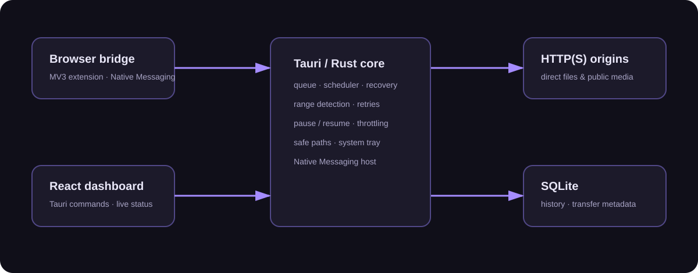

# REA Idm Mangaer

<p align="center"><b>A privacy-minded Windows download manager built with Tauri, Rust, React, TypeScript, and SQLite.</b></p>



> **Name note:** This project intentionally uses the requested product name, **REA Idm Mangaer**. It is an independent application and is not affiliated with Internet Download Manager or its vendors.

## What works today

- Direct HTTP(S) downloads with HEAD capability probing, redirects handled by the HTTP client, retry, pause, queued recovery after application restart, progress, instantaneous transfer rate, estimated completion time, and a configurable global speed cap.
- Concurrent byte-range downloading for compatible files ≥2 MiB. The engine creates a temporary `.part` file, downloads independent ranges concurrently, then atomically promotes it to its final name only after success.
- SQLite-backed local history and transfer metadata, safe Windows filename sanitization, type categorization, bounded filenames, and database WAL mode.
- A polished responsive React dashboard: active/queued/completed/paused/failed/scheduled filters, live statistics, drag-and-drop/paste URL handling, empty states, and dark/light themes.
- System-tray operation: closing the main window hides it while transfers continue. The tray menu can restore the window or quit. Optional per-user Windows autostart is exposed by the Rust command layer.
- Chromium browser bridge for Chrome, Microsoft Edge, Brave, Opera, and Vivaldi, plus Firefox MV3 manifest support. It provides a context menu and identifies direct downloadable media responses.
- Secure native messaging design: per-user manifests, framed stdin/stdout protocol, a locally generated token, URL scheme validation, and no shell interpolation.

## Architecture

The engine is purpose-built; it does **not** use REA or Internet Download Manager code or an external download engine. The optional REA repository mentioned in the project brief was not needed to implement the independent architecture.

| Area | Implementation |
| --- | --- |
| Desktop | Tauri 2, Rust, system tray, local autostart integration |
| UI | React 19 + TypeScript + Vite |
| Engine | Reqwest streaming, range discovery, Tokio concurrent tasks, throttling |
| Persistence | SQLite (bundled `rusqlite`) with WAL |
| Browser handoff | Manifest V3 extension + Native Messaging host |

## Requirements

- Windows 10/11 with WebView2 Runtime
- Node.js 20+ and pnpm
- Rust stable with MSVC C++ build tools (only for development/building)

## Development

```powershell
pnpm install
pnpm check
pnpm tauri:dev
```

Create an installable package with `pnpm tauri:build`. The application stores its local SQLite database beneath its Windows app data directory and finished files in `Downloads\REA Idm Mangaer` unless a destination is supplied.

## Browser extension setup

1. Build the extension: `pnpm extension:build`.
2. Build the Rust native host and identify `rea-idm-native-host.exe`.
3. In a PowerShell prompt, run:

   ```powershell
   .\scripts\install-browser-bridge.ps1 -NativeHostPath 'C:\path\to\rea-idm-native-host.exe' -ChromiumExtensionId '<your-unpacked-extension-id>'
   ```

4. Open the relevant browser’s extension page and enable Developer mode:
   - Chrome, Edge, Brave, Opera, Vivaldi: choose **Load unpacked**, then select `extension\build`; rename `manifest.chromium.json` to `manifest.json` first.
   - Firefox: package/load the directory with `manifest.firefox.json` renamed to `manifest.json`; use `about:debugging` for temporary developer loading. Signing is required for normal Firefox distribution.

The bridge only submits direct HTTP(S) URLs. It never reads passwords or cookies and does not bypass DRM. YouTube pages are detected and clearly declined: direct, explicitly authorized media URLs may be downloaded, but protected streams, authentication-gated content, DRM, and page/video extraction are not supported. Safari is not supported because its native extension distribution and messaging model require an Apple/macOS host app, which is outside this Windows-only application.

To unregister the local bridge before uninstalling the app, run `./scripts/uninstall-browser-bridge.ps1`, then remove the extension from each browser.

## Safety and limitations

- Downloads must be authorized by the user and lawful in their jurisdiction. Servers can disable ranges, reject HEAD, rate-limit requests, or require authentication; those cases are surfaced as failures rather than circumvented.
- Pause for a multi-segment transfer safely stops its workers; current version restarts that transfer on resume rather than preserving partial per-segment maps. Completed records and queued crash recovery are persisted.
- Scheduling data model and views are present, while a calendar editor and scheduled-worker trigger are planned follow-up work.
- File previews, OS notifications, and an in-app settings screen are not yet implemented. The native notification and dialog plugins are present for the next UI phase.

## Quality checks

Run `pnpm check` for TypeScript, ESLint, unit tests, production frontend build, and extension assembly. Run `cargo test --manifest-path src-tauri/Cargo.toml` for Rust tests and `pnpm tauri:build` for the Windows installer.

## License

Released under the [MIT License](LICENSE).
